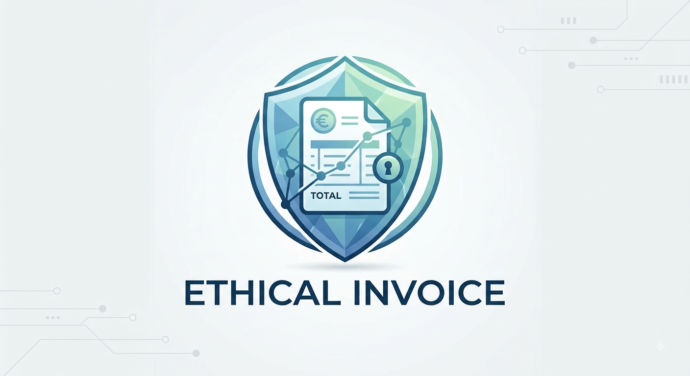
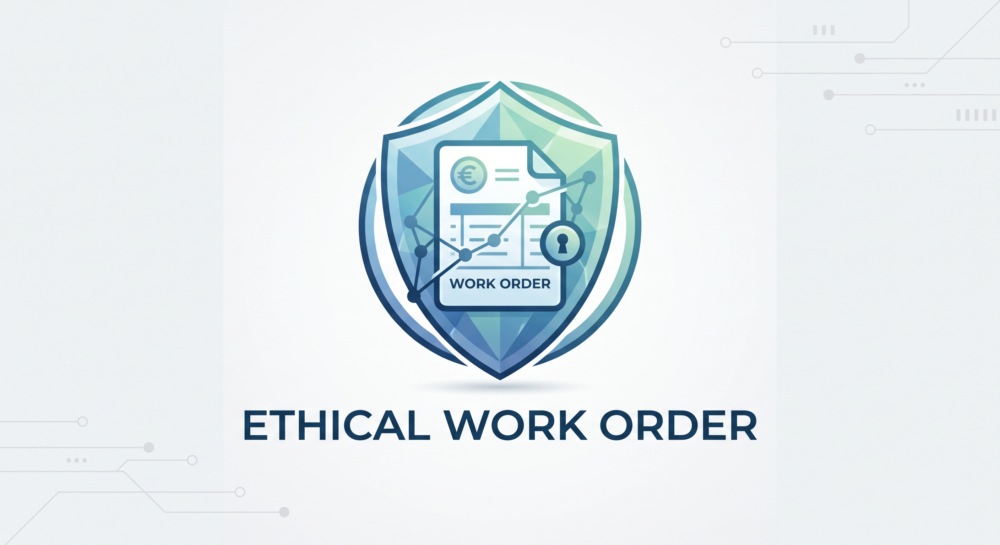

# Ethical Docs

Fully local, single-file document generators for **authorized red teaming and social engineering engagements**. Two tools, one repo — an invoice generator and a work order generator. Both run entirely in your browser: no network, no dependencies, nothing leaves the page.

Maintained by [@connor-sec](https://github.com/connor-sec).

| Tool | File | What it's for |
|------|------|---------------|
| **Ethical Invoice** | [`Ethical_Invoice.html`](Ethical_Invoice.html) | Professional multi-address invoices with line items, tax/discount, multi-currency, signature block |
| **Ethical Work Order** | [`Ethical_WorkOrder.html`](Ethical_WorkOrder.html) | Professional multi-address work orders with job details, checklists, work-performed notes, signature block |

    
    

## Usage

Download either `.html` file and open it in any modern browser (Chrome, Firefox, Edge, Safari). That's it — no install, no server, no internet required. Keep them on a laptop or USB drive and use them anywhere.

## ⚠️ Authorized use only — for security research and authorized testing

**Authorized use.** These tools are intended exclusively for legitimate security testing, red team exercises, penetration testing, purple team activities, and security awareness programs conducted under proper written authorization. Use them only within an expressly authorized and documented testing scope.

**Illegal use is prohibited.** Creating or distributing invoices or work orders for fraud, unauthorized access, phishing or pretexting without consent, or any other illegal activity is strictly forbidden and may violate applicable laws. Authorization must come from the target organization (or from ownership / explicit permission to test).

**No data collection.** The tools run entirely in your browser. They do not transmit, store, or process any document data outside of your local machine (optional `localStorage` drafts stay on your device only).

**Warranty.** Provided "as is", without warranty of any kind. This is not legal advice. The authors accept no liability for misuse.

## Why this exists

Realistic paperwork is one of the most effective and commonly used pretexts in social engineering and physical security assessments. Invoices carry financial weight; work orders justify presence at a facility and often receive less scrutiny. Both support multi-location service scenarios.

Public online generators are convenient but require sending data to third-party servers and often leave traces. This project exists to give red teamers and security professionals a clean, fully offline alternative — single HTML files that produce professional multi-page documents for authorized engagements, especially those involving multiple service locations or sites.

Nothing is ever uploaded. Everything stays under your control.

## Features

Shared by both tools:

- **100% client-side** — No backend, no accounts, no telemetry. Your data never leaves the browser.
- **Multi-address support** — Add up to **10 service locations / job sites**. Printing automatically generates one page per address, with sequential document numbers.
- **Professional layout** — Clean, modern design suitable for real engagements.
- **Logo upload** — Add a company logo that appears on the printed pages.
- **Signature block** — Point-of-contact name, title, authorizing party, date, and a customizable cursive-style signature (font + size).
- **Notes** — Free-text area for terms, access codes, parking instructions, safety notes, or other context.
- **Local drafts** — Save and reload drafts using browser `localStorage`.
- **Print to PDF** — Native browser print dialog produces a multi-page PDF.

**Ethical Invoice** adds:

- **Flexible line items** — Quantity, rate, and amount fields (editing the amount automatically adjusts the rate).
- **Tax & discount** — Percentage tax rate plus flat discount support.
- **Multi-currency** — Select from common currencies.

**Ethical Work Order** adds:

- **Work order fields** — WO number, date, priority, status, job type, scheduled date, assigned technician/crew, and requested-by.
- **Checklist** — Task items with checkboxes for on-site work tracking.
- **Work performed** — Free-text area to describe completed work when closing the order.

## How to Print / Generate PDF

1. Fill out the document (company details, line items or job info, service addresses, signature, etc.).
2. Click the **Print / Download PDF** button.
3. In the browser print dialog:
   - Destination → **Save as PDF** (or "Microsoft Print to PDF")
   - Layout → **Portrait**
   - Margins → **None** or **Minimum**
   - Background graphics → **Enabled** (so colors and the logo appear correctly)
4. Save the file.

**Tip:** When multiple service addresses are added, each address becomes its own page with a sequential document number.

## Multi-Address Behavior

- **0 addresses** → one page is generated.
- **1–10 addresses** → one page is generated **per address**.
- Document numbers can auto-increment across pages when multiple addresses are present.
- Each page clearly shows the corresponding **Service Address / Location**.

This is especially useful for multi-site or multi-campus engagements.

## Privacy & Technical Details

| Aspect                  | Detail                                      |
|-------------------------|---------------------------------------------|
| Stack                   | Single HTML file each (HTML + CSS + Vanilla JS) |
| Network                 | None — works fully offline                  |
| Dependencies            | Zero                                        |
| Storage                 | Optional browser `localStorage` only        |
| Max service addresses   | 10                                          |
| Browser support         | Modern evergreen browsers                   |

- No analytics
- No external fonts or scripts (except system fonts)
- Logo images and all document data remain in memory / localStorage on your machine

## History

This repo merges two previously separate projects, `ethical-invoice` and `Ethical-WorkOrder`, which shared almost all of their code and documentation.

## License

This project is released under the [MIT License](LICENSE).
